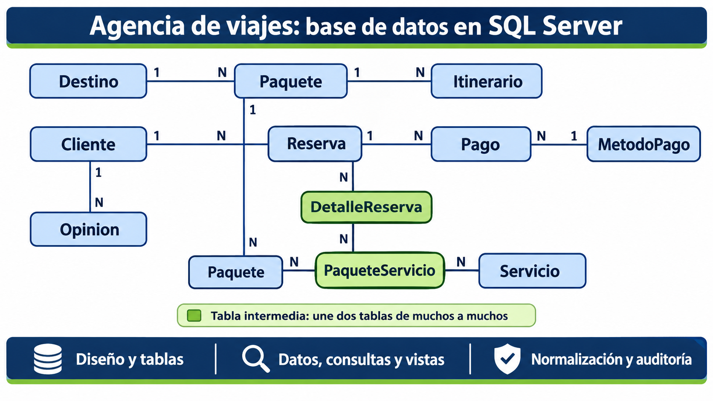

# Agencia de viajes: base de datos en SQL Server

Base de datos para una agencia de viajes que registra clientes, paquetes turísticos, reservas, pagos y opiniones. El proyecto recorre todo el proceso: diseño, creación de las tablas, datos de prueba, diagrama entidad-relación, consultas, vistas, procedimientos almacenados y normalización. Cada paso está documentado y comprobado con capturas.

<p align="center">  </p>

## Tecnologías

- SQL Server 2025 (edición Standard Developer)
- SQL Server Management Studio 22
- Autenticación de Windows

## Estructura

```
agencia-viajes-sqlserver/
├── README.md
├── LICENSE
├── SECURITY.md
├── docs/
│   ├── 00-entorno.md
│   ├── 01-fases-de-diseno.md
│   ├── 02-creacion-base-y-tablas.md
│   ├── 03-insercion-de-datos.md
│   ├── 04-diagrama-y-relaciones.md
│   └── 05-normalizacion.md
├── sql/
│   ├── 01-creacion-base-y-tablas.sql
│   └── 02-datos.sql
├── auditoria/
│   ├── consultas.md
└── evidencia/
```

## Contenido

### docs/

Explica cómo se construyó la base y por qué.

| Archivo | Contenido |
|---|---|
| `00-entorno.md` | Instalación de SQL Server y SSMS, y primera conexión a la instancia local |
| `01-fases-de-diseno.md` | Requisitos, diseño conceptual, diseño lógico y supuestos |
| `02-creacion-base-y-tablas.md` | Creación de la base y de las 11 tablas, con sus llaves primarias y foráneas |
| `03-insercion-de-datos.md` | Datos de prueba inventados, orden de inserción y verificación |
| `04-diagrama-y-relaciones.md` | Diagrama entidad-relación y tipo de relación entre las tablas |
| `05-normalizacion.md` | Revisión de 1FN, 2FN y 3FN y dependencias encontradas |

### sql/

Los dos scripts largos, para ejecutarlos directamente.

| Archivo | Contenido |
|---|---|
| `01-creacion-base-y-tablas.sql` | Creación de las 11 tablas |
| `02-datos.sql` | Inserción de los datos de prueba |

### auditoria/

Pruebas de que todo funciona. Las sentencias están escritas en el propio archivo, junto con la captura del resultado.

| Archivo                    | Contenido                                          |
| -------------------------- | -------------------------------------------------- |
| `consultas.md`             | Consultas con su resultado esperado y su captura   |

## Cómo reproducirlo

1. Instala SQL Server y SSMS (ver `docs/00-entorno.md`).
2. En SSMS, crea la base de datos: `CREATE DATABASE agencia_viajes;`
3. Ejecuta `sql/01-creacion-base-y-tablas.sql`.
4. Ejecuta `sql/02-datos.sql`.

Los scripts se ejecutan una sola vez y en ese orden. Si se repiten sin vaciar las tablas, los ids generados automáticamente siguen subiendo y las llaves foráneas del script de datos dejan de coincidir.

## Licencia

Ver el archivo `LICENSE`.
