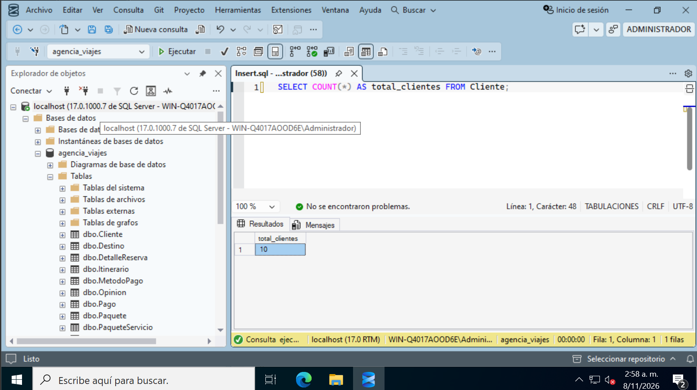
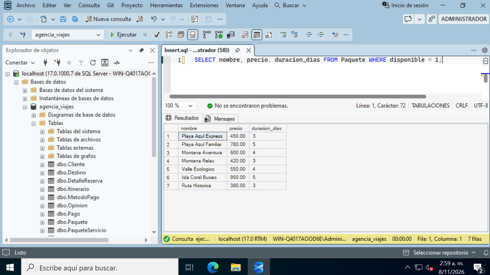
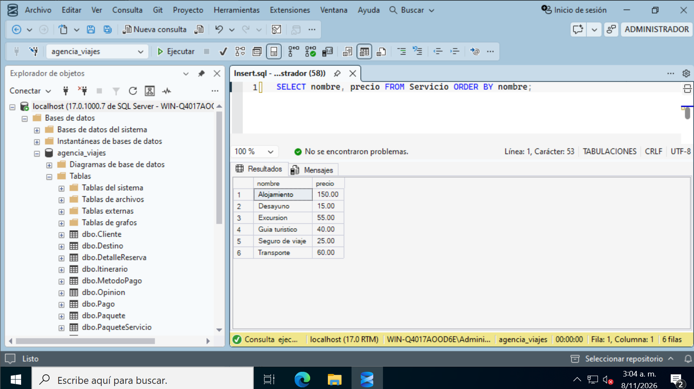
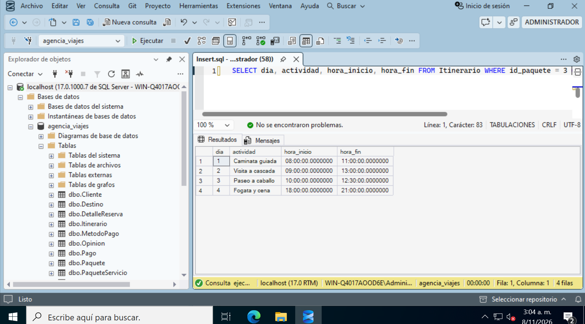
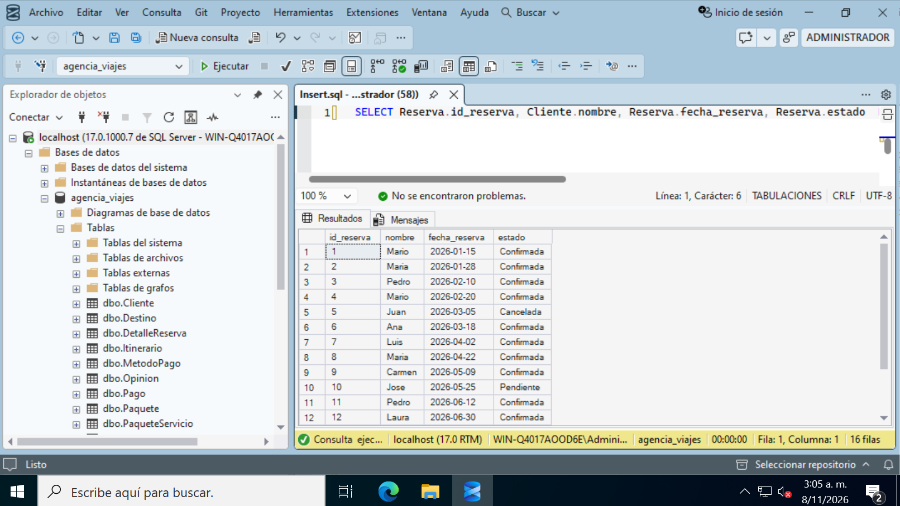

# Auditoría - Consultas

> **Alcance:** comprobaciones simples sobre `agencia_viajes` para verificar que los datos y las relaciones quedaron bien cargados. Cada una tiene la sentencia, el resultado esperado según el script de datos y la captura del resultado. **No incluye:** las consultas del proyecto (`sql/03-consultas.sql`).

## 1. Total de clientes

Comprueba que se insertaron todos los clientes.

```sql
SELECT COUNT(*) AS total_clientes FROM Cliente;
```

**Esperado:** 10.

<p align="center"></p>

## 2. Paquetes disponibles

Comprueba el filtro por `disponible`.

```sql
SELECT nombre, precio, duracion_dias FROM Paquete WHERE disponible = 1;
```

**Esperado:** 7 filas. Quedan fuera `Valle Cultural` e `Isla Coral Completo`.

<p align="center"></p>

## 3. Servicios en orden alfabético

Comprueba el ordenamiento.

```sql
SELECT nombre, precio FROM Servicio ORDER BY nombre;
```

**Esperado:** 6 filas, de `Alojamiento` a `Transporte`.

<p align="center"></p>

## 4. Itinerario de un paquete

Comprueba que las actividades quedaron ligadas a su paquete.

```sql
SELECT dia, actividad, hora_inicio, hora_fin FROM Itinerario WHERE id_paquete = 3 ORDER BY dia;
```

**Esperado:** 4 filas, del día 1 al 4, que empiezan con `Caminata guiada` y terminan con `Fogata y cena`.

<p align="center"></p>

## 5. Reservas con el nombre del cliente

Comprueba que la llave foránea `id_cliente` conecta `Reserva` con `Cliente`.

```sql
SELECT Reserva.id_reserva, Cliente.nombre, Reserva.fecha_reserva, Reserva.estado  FROM Reserva  JOIN Cliente ON Reserva.id_cliente = Cliente.id_cliente;
```

**Esperado:** 16 filas, una por reserva, cada una con el nombre de su cliente.

<p align="center"></p>
