# 00 - Entorno

> **Fase:** 0 (Entorno) **Alcance:** descarga e instalación de SQL Server 2025 (edición Standard Developer) con el motor de base de datos, instalación de SQL Server Management Studio (SSMS) 22 y primera conexión a la instancia local. **No incluye:** la creación de la base de datos ni de las tablas, que van en `02-creacion-base-y-tablas.md`. **Estado:** la instancia local está instalada y la conexión desde SSMS está preparada; la captura de la conexión exitosa está pendiente.

## 1. Resultado de esta fase

|Parámetro|Valor|
|---|---|
|Producto|SQL Server 2025, edición Standard Developer|
|Tipo de instalación|Personalizada (Custom)|
|Características instaladas|Servicios del motor de base de datos (Database Engine Services)|
|Instancia|Predeterminada (`MSSQLSERVER`)|
|Cuentas de servicio|Las que propone el asistente|
|Modo de autenticación|Autenticación de Windows|
|Administrador de SQL Server|Usuario de Windows actual|
|Herramienta de administración|SQL Server Management Studio 22 (versión 22.11.3)|
|Conexión|Servidor `localhost`, autenticación de Windows|

## 2. Descarga de SQL Server

### 2.1 Página de descargas

Desde la página oficial de descargas de SQL Server de Microsoft se accede a las opciones de instalación local.

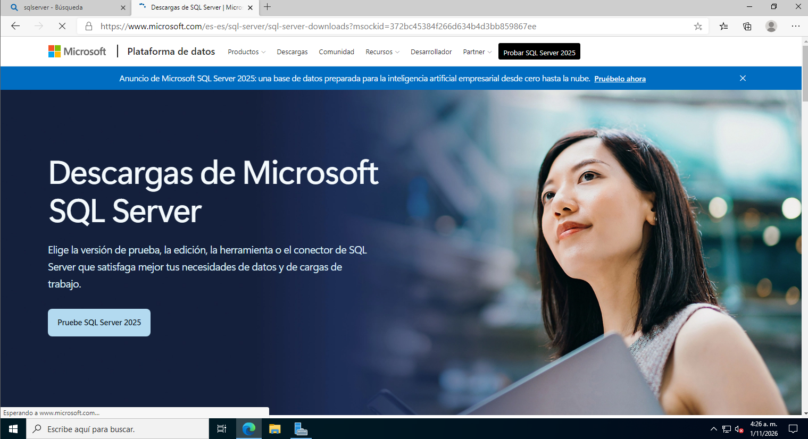

### 2.2 Elección de la edición

Se elige la edición **Standard Developer**. Según el propio asistente de instalación, esta edición no caduca, incluye las mismas características que la edición Standard y está licenciada solo para desarrollo de aplicaciones de base de datos fuera de producción. Por eso encaja con un proyecto de práctica.

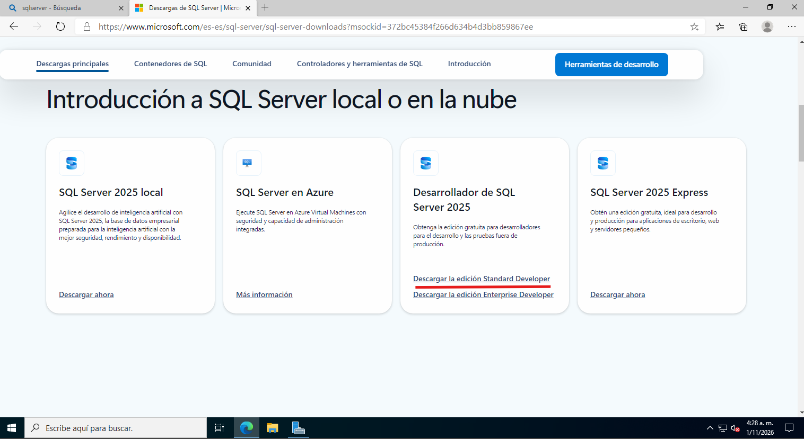

**Recurso complementario:** [PENDIENTE: enlace]

### 2.3 Tipo de instalación y descarga de los archivos

El instalador ofrece tres opciones: **Basic** (instala el motor con la configuración por defecto), **Custom** (abre el asistente completo para elegir qué instalar) y **Download Media** (solo descarga los archivos). Se selecciona **Custom** para poder revisar cada decisión de configuración.

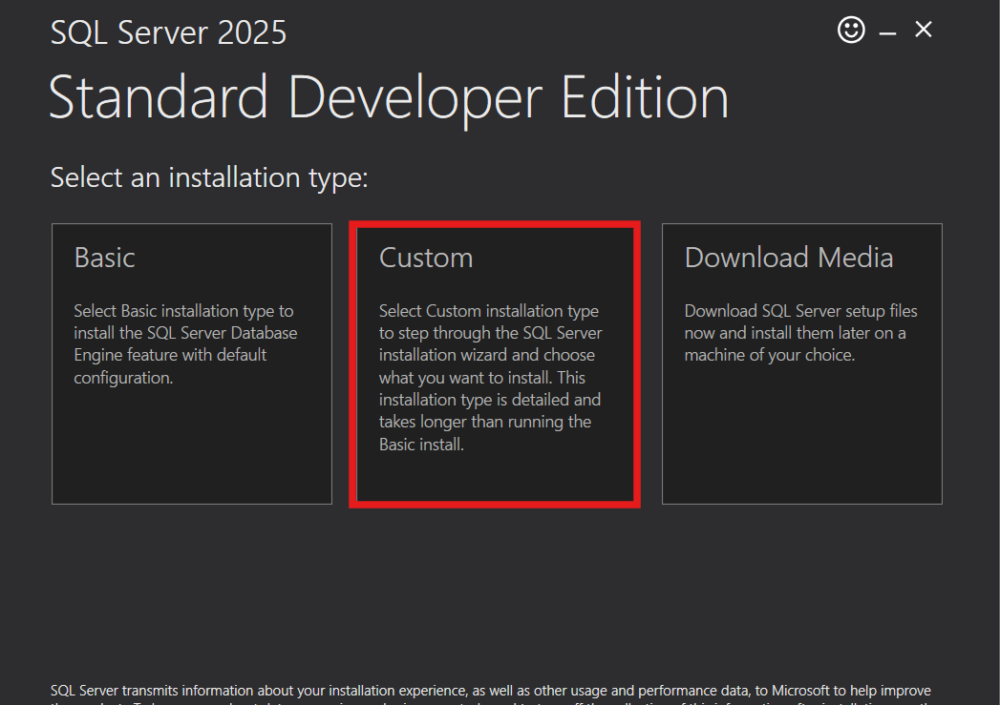

A continuación se indica dónde se descargan los archivos de instalación:

|Parámetro|Valor|
|---|---|
|Idioma|English|
|Ubicación de los archivos|`C:\SQL2025`|
|Espacio libre mínimo requerido|8752 MB|
|Tamaño de la descarga|1311 MB|

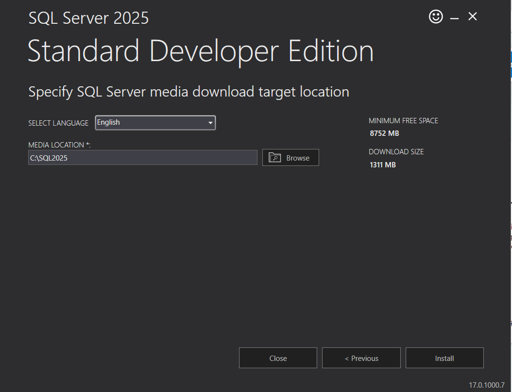

Se pulsa **Install** y comienza la descarga del paquete.

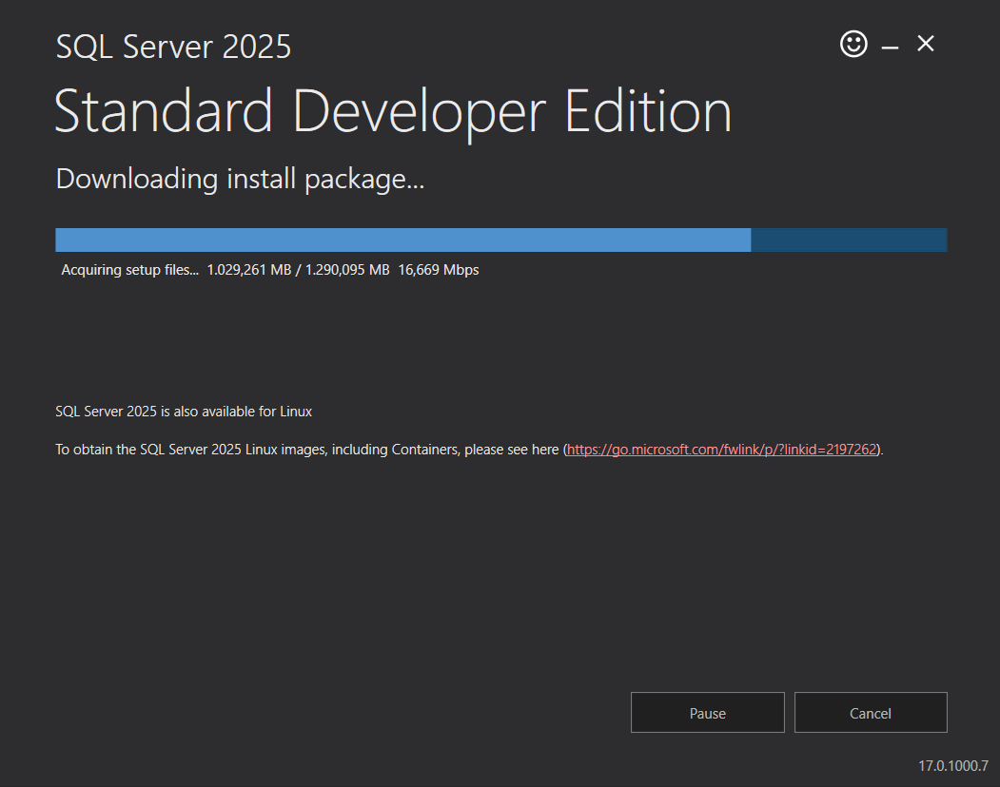

## 3. Asistente de instalación del motor

### 3.1 Nueva instalación independiente

Al terminar la descarga se abre el Centro de instalación de SQL Server. Se selecciona **New SQL Server standalone installation or add features to an existing installation**, que lanza el asistente para instalar SQL Server en un entorno sin clúster.

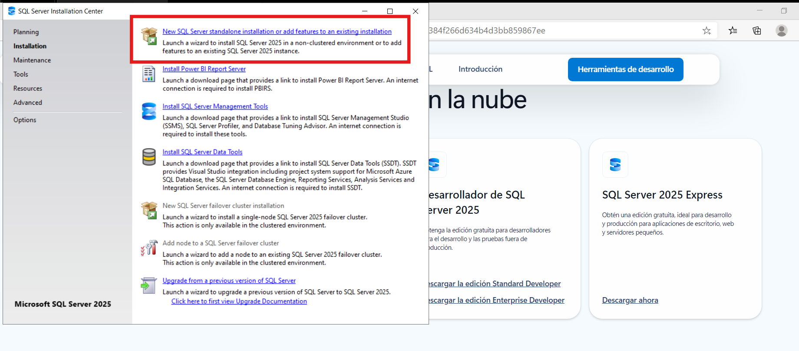

### 3.2 Edición y licencia

En **Edition** se mantiene seleccionada la opción de edición gratuita **Standard Developer**. Después se aceptan los términos de licencia.

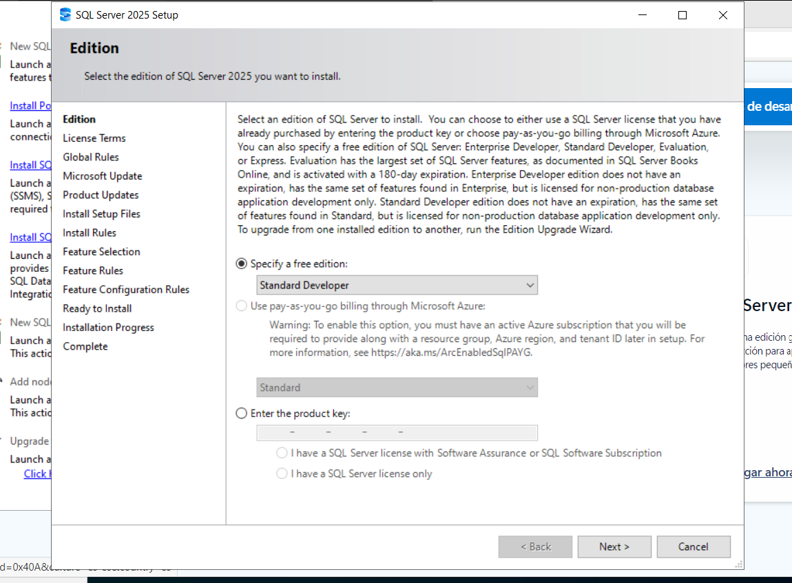

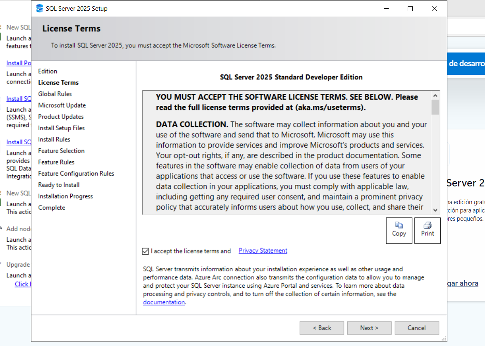

### 3.3 Reglas de instalación

Las reglas de instalación detectan problemas que podrían impedir la instalación. El resultado es: 4 reglas superadas, 0 fallidas y 1 advertencia.

|Regla|Resultado|
|---|---|
|Soporte de característica compartida de Machine Learning Server|Superada|
|Validación de consistencia de las claves del registro de SQL Server|Superada|
|Equipo como controlador de dominio|Superada|
|Firewall de Windows|Advertencia|
|Microsoft .NET Framework 4.7.2 o superior|Superada|

La advertencia del Firewall de Windows no impide continuar. Suele referirse a abrir puertos para acceso remoto al motor; como las conexiones de este proyecto son locales, no se modifica el firewall. [PENDIENTE: confirmar el motivo leyendo el informe detallado de la regla]

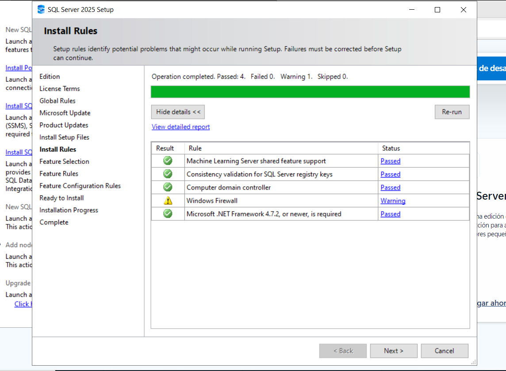

### 3.4 Selección de características

Solo se marca **Database Engine Services**, el servicio principal que almacena, procesa y protege los datos. Las demás características (replicación, servicios de IA, búsqueda de texto completo, PolyBase, Analysis Services e Integration Services) quedan sin marcar porque este proyecto no las necesita. Los directorios de instalación se dejan en sus valores por defecto.

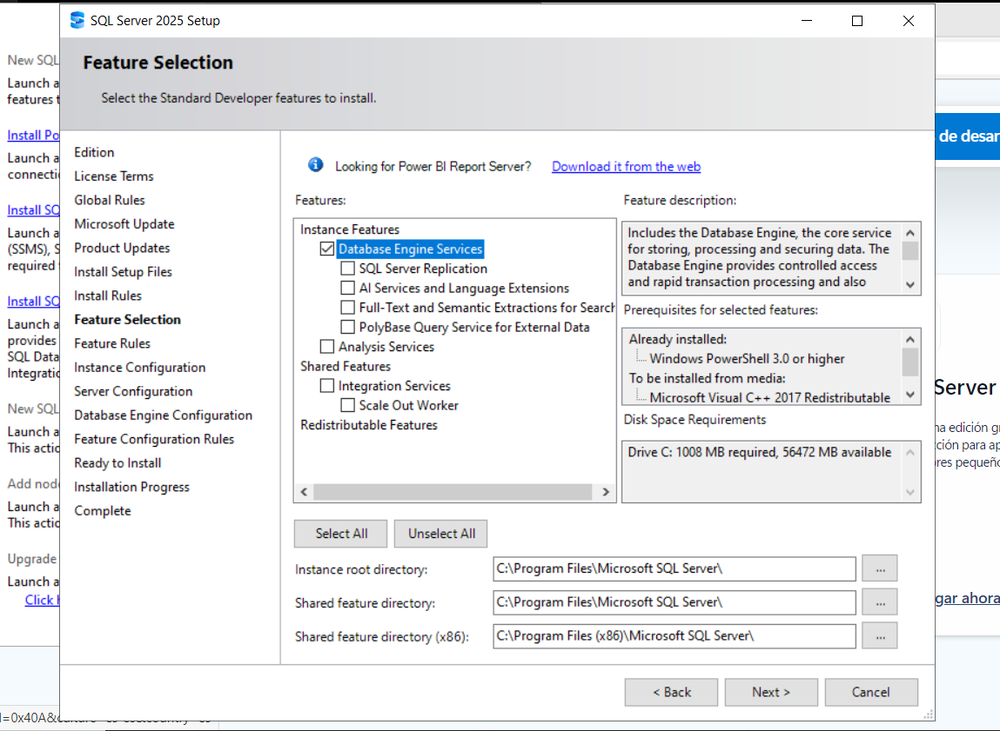

### 3.5 Configuración de la instancia

Se usa la **instancia predeterminada**, cuyo identificador es `MSSQLSERVER`. Con una instancia predeterminada, la conexión local se hace simplemente con `localhost`, sin añadir un nombre de instancia.

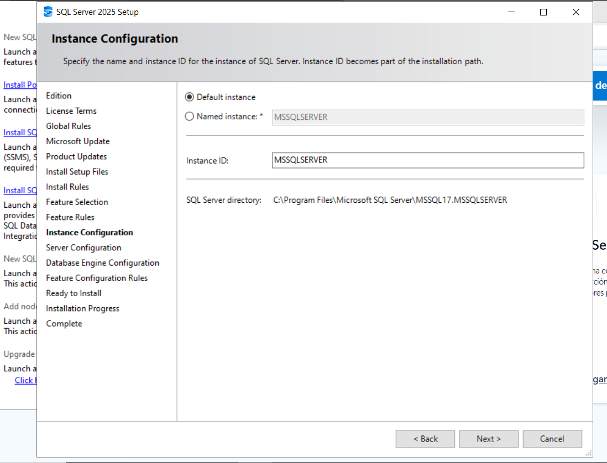

### 3.6 Configuración del servidor

Se dejan las cuentas de servicio y los tipos de inicio que propone el asistente:

|Servicio|Cuenta|Tipo de inicio|
|---|---|---|
|SQL Server Agent|`NT Service\SQLSERVERAGENT`|Manual|
|SQL Server Database Engine|`NT Service\MSSQLSERVER`|Automático|
|SQL Server Browser|`NT AUTHORITY\LOCAL SERVICE`|Deshabilitado|

El privilegio **Perform Volume Maintenance Tasks** queda sin marcar. La pestaña **Collation** (ordenamiento) no se capturó. [PENDIENTE: indicar si se dejó el valor por defecto]

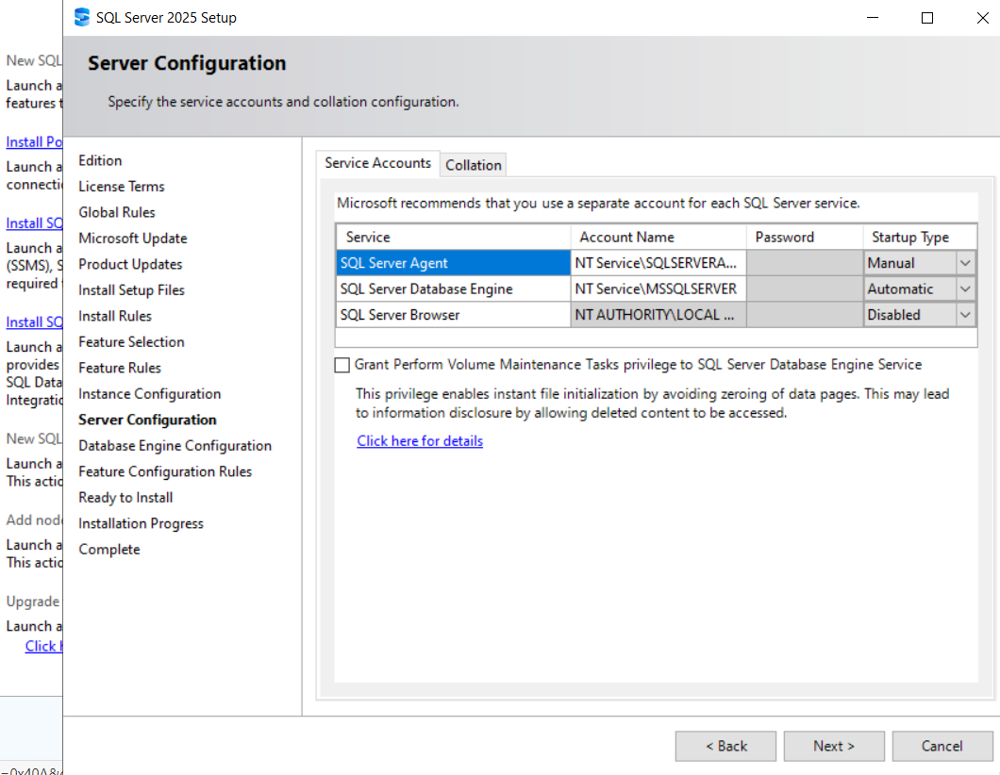

### 3.7 Configuración del motor de base de datos

|Parámetro|Valor|
|---|---|
|Modo de autenticación|Windows authentication mode|
|Administradores de SQL Server|Usuario de Windows actual (agregado con **Add Current User**)|

Se usa solo la autenticación de Windows: SQL Server confía en la cuenta de Windows con la que se inició sesión, por lo que no se activa el modo mixto ni se define contraseña para la cuenta `sa`. Esto evita manejar credenciales propias de SQL Server en un proyecto que es local.

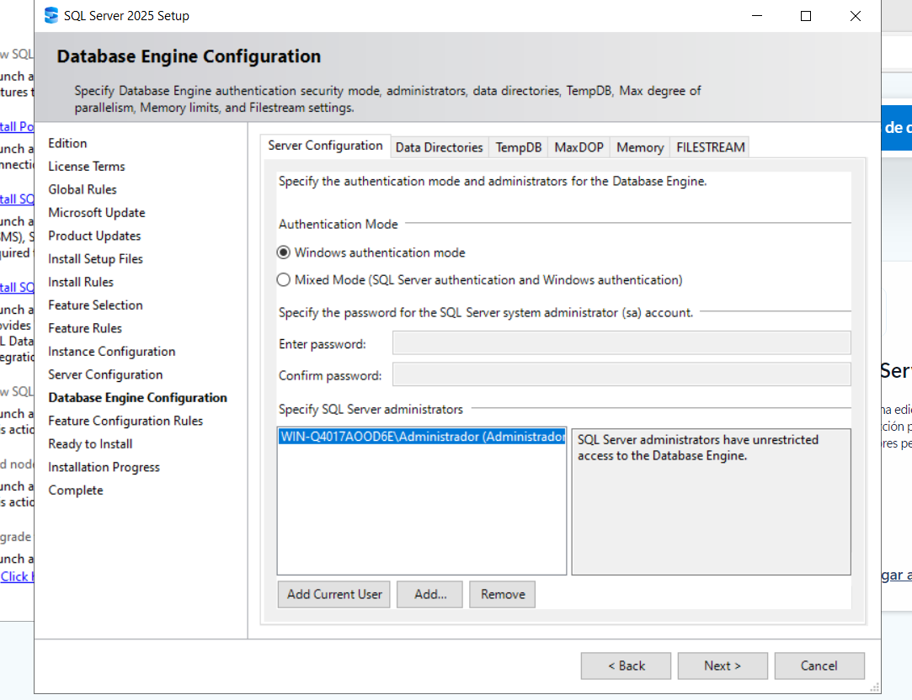

**Recurso complementario:** [PENDIENTE: enlace]

### 3.8 Finalización

Los pasos intermedios sin captura (reglas globales, actualizaciones, reglas de características, resumen previo a la instalación y progreso) se avanzaron sin cambios. [PENDIENTE: confirmar]

El asistente termina correctamente, con actualizaciones de producto incluidas:

|Característica|Estado|
|---|---|
|Database Engine Services|Succeeded|
|SQL Browser|Succeeded|
|SQL Writer|Succeeded|
|Setup Support Files|Succeeded|

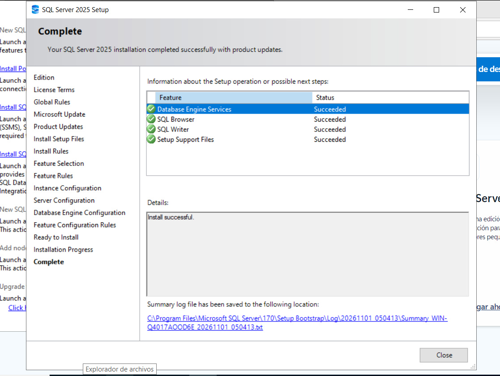

## 4. Instalación de SQL Server Management Studio (SSMS)

El motor de base de datos es el servicio que almacena los datos; SSMS es la herramienta gráfica desde la que se escribe SQL y se administra ese servicio. Son instalaciones separadas.

### 4.1 Acceso al instalador

En el Centro de instalación se selecciona **Install SQL Server Management Tools**, que abre una página de descarga.

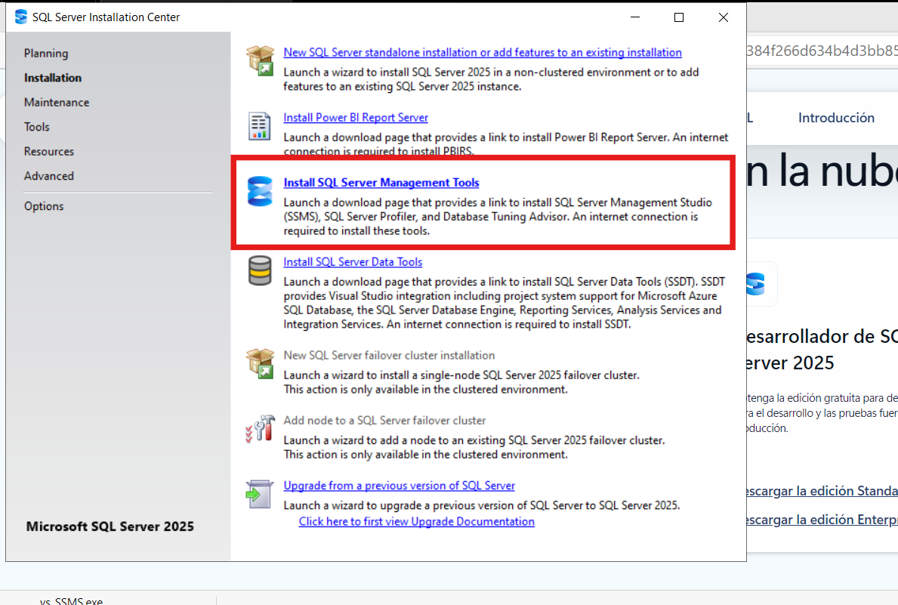

La documentación oficial indica que SSMS 22 se instala con el instalador de Visual Studio: el vínculo descarga un instalador pequeño (`vs_SSMS.exe`) que abre el Instalador de Visual Studio, y no existe un instalador `.msi` independiente.

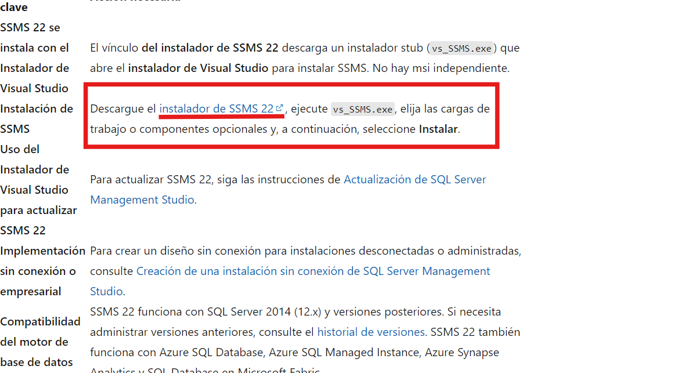

**Recurso complementario:** [PENDIENTE: enlace]

### 4.2 Selección de componentes e instalación

|Parámetro|Valor|
|---|---|
|Producto|SQL Server Management Studio 22 (22.11.3)|
|Carga de trabajo seleccionada|Híbrido y migración|
|Otras cargas de trabajo|Sin marcar|
|Espacio total necesario|3,89 GB|

Se pulsa **Instalar**.

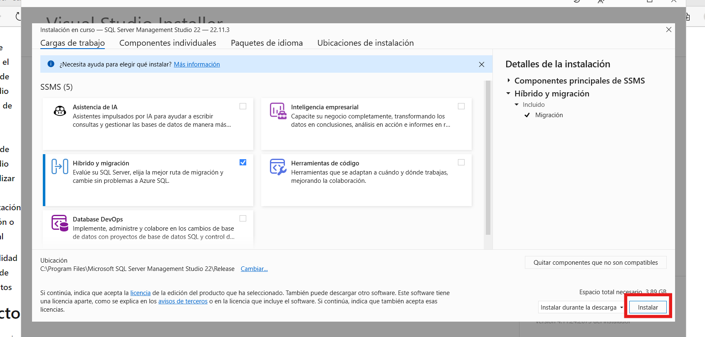

Al terminar, el instalador indica que todas las instalaciones están actualizadas y muestra SSMS 22 en la versión 22.11.3.

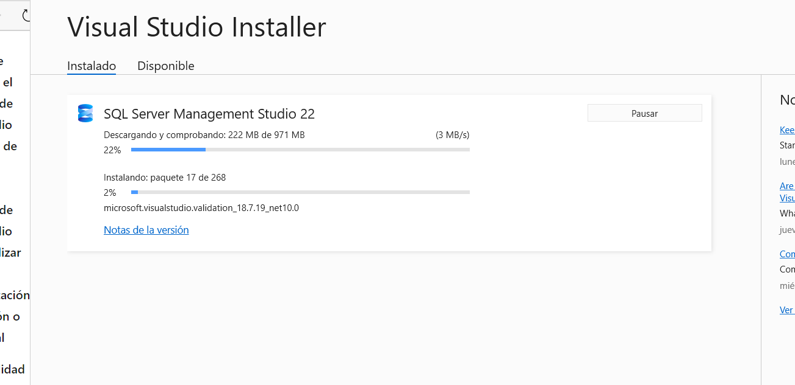

## 5. Primera conexión a la instancia

Al abrir SSMS aparece la ventana **Conectar** con estos valores:

|Parámetro|Valor|
|---|---|
|Nombre del servidor|`localhost`|
|Autenticación|Autenticación de Windows|
|Contraseña|No aplica (se usa la cuenta de Windows)|
|Nombre de la base de datos|`<predeterminado>`|
|Cifrar|Opcional|
|Certificado de servidor de confianza|Desmarcado|

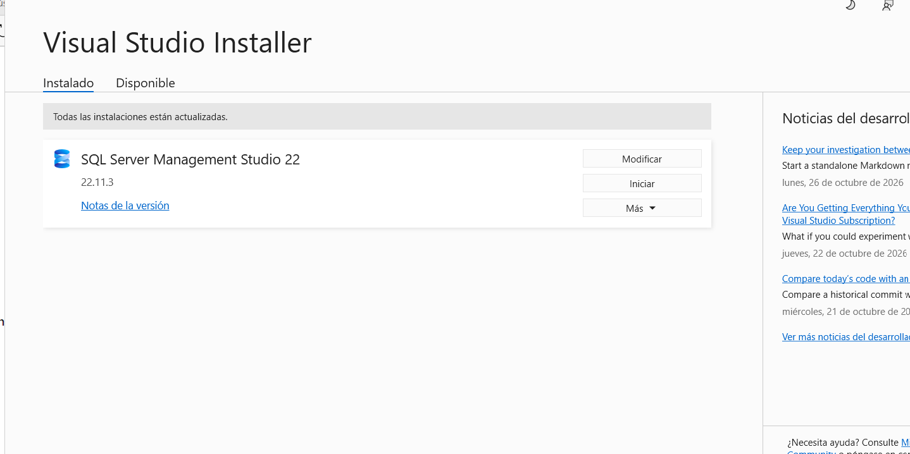

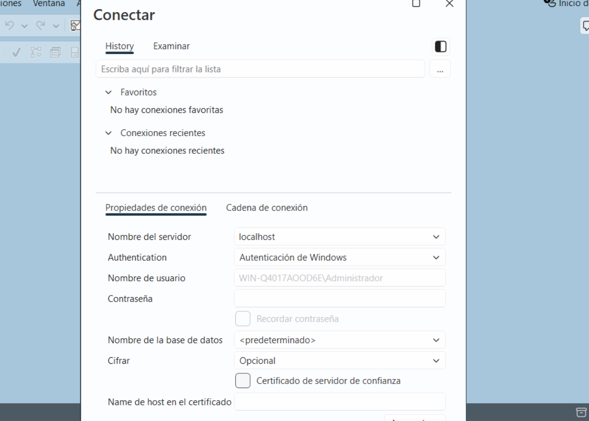

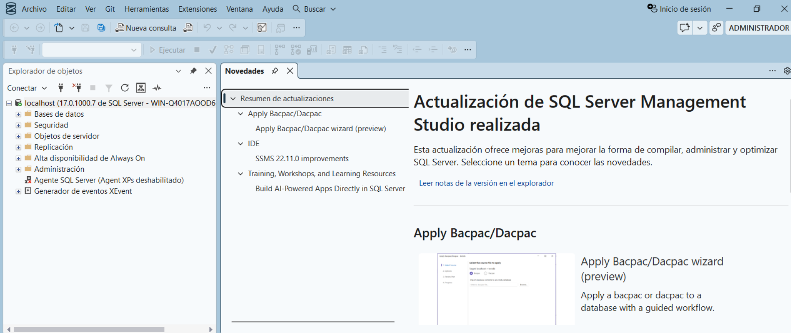

Al conectar, el Explorador de objetos muestra la instancia y se confirma el acceso a la base de datos.

## 6. Estado y alcance de esta fase

|Elemento|Estado|
|---|---|
|SQL Server 2025 Standard Developer instalado|Hecho|
|Instancia predeterminada con autenticación de Windows|Hecho|
|SSMS 22 instalado|Hecho|
|Conexión a `localhost` desde SSMS|Pendiente de captura|
|Base de datos y tablas|Pendiente|

**Siguiente:** `01-fases-de-diseno.md`, donde se documentan las fases de diseño de la base de datos antes de crearla en SQL Server.
