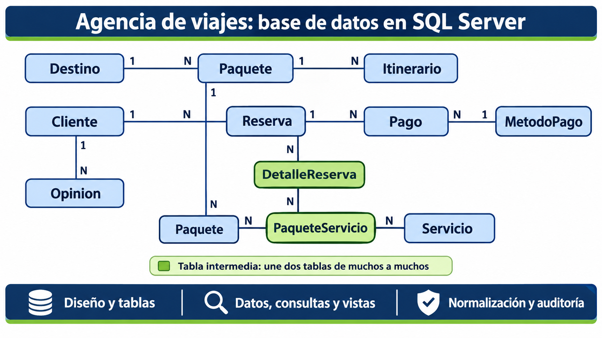

# 01 - Fases de diseño

> **Fase:** 1 (Diseño) **Alcance:** diseño de la base de datos de la agencia de viajes antes de crearla en SQL Server: requisitos, diseño conceptual, diseño lógico y supuestos de diseño. **No incluye:** la creación de la base ni de las tablas (`02-creacion-base-y-tablas.md`), el diagrama entidad-relación definitivo ni la explicación detallada de las relaciones (`04-diagrama-y-relaciones.md`), ni la normalización (`05-normalizacion.md`). **Estado:** diseño completo; es la base sobre la que se crean las tablas en la siguiente fase.

## 1. Resultado de esta fase

| Fase                      | Producto obtenido                                                                                       |
| ------------------------- | ------------------------------------------------------------------------------------------------------- |
| 1. Análisis de requisitos | Lista de diez necesidades de información que la base debe poder responder (sección 3)                   |
| 2. Diseño conceptual      | Once entidades con sus atributos principales y nueve relaciones (sección 4)                              |
| 3. Diseño lógico          | Diez tablas con su llave primaria y sus llaves foráneas, y la cardinalidad de cada relación (sección 5) |

## 2. Diagrama del diseño

Esquema general de lo que se quiere construir, a modo de boceto previo: una caja por entidad y una línea por relación, sin columnas. El diagrama entidad-relación definitivo, ya con la base creada, se presenta en `04-diagrama-y-relaciones.md`.

El boceto representa las once entidades de la sección 4 y las relaciones que las conectan.

## 3. Fase 1: análisis de requisitos

El sistema debe permitir a una agencia de viajes registrar a sus clientes, los paquetes turísticos que ofrece, las reservas y pagos que se realizan, y la opinión que los clientes dan sobre su experiencia. A partir de esa información debe poder generar reportes comerciales (ventas por destino, ingresos por mes) y consultas de atención al cliente (reservas y compras de cada persona).

El análisis de requisitos consiste en partir de lo que el sistema debe responder y deducir qué información hay que guardar para poder responderlo. La lista siguiente se obtiene de las consultas, vistas y procedimientos que debe soportar la base:

|N.º|Necesidad|Información que implica guardar|
|---|---|---|
|1|Listar los clientes con sus datos personales|Datos personales de cada cliente|
|2|Conocer cuántas reservas ha hecho cada cliente|Qué reservas existen y a qué cliente pertenece cada una|
|3|Mostrar los paquetes disponibles con precio, duración y destino|Paquetes, su precio, su duración, su destino y si están disponibles|
|4|Consultar el itinerario de un paquete, con actividades y horarios|Actividades y horarios asociados a cada paquete|
|5|Contar los paquetes vendidos por destino, de mayor a menor|Qué paquete incluye cada venta y el destino de cada paquete|
|6|Resumir ingresos por mes, método de pago y destino|Fecha de cada pago, monto, método de pago y destino del paquete|
|7|Calcular el porcentaje de opiniones positivas y negativas por fecha y destino|Opinión de cada cliente, su fecha y el destino al que se refiere|
|8|Ofrecer una vista de paquetes y reservas con la definición cifrada|Relación entre paquetes y reservas|
|9|Obtener, a partir del ID de un cliente, el total de sus compras y todos sus datos|Monto de cada compra asociada al cliente|
|10|Ofrecer una vista con los precios de los servicios en orden alfabético|Servicios y su precio|

Además de estas necesidades, el diseño debe cubrir los requisitos de estructura del proyecto: entidades con atributos, llaves primarias y foráneas, y datos de prueba suficientes para poder verificar cada consulta.

## 4. Fase 2: diseño conceptual

En esta fase se identifican las cosas que existen en el negocio (entidades), qué se sabe de cada una (atributos) y cómo se relacionan entre sí, sin pensar todavía en SQL Server, tipos de datos ni código. El resultado es un esquema entidad-relación a alto nivel. Para encontrarlas se agrupó la información de la sección 3 según de qué cosa habla: si una "cosa" puede existir muchas veces y tiene datos propios, es una entidad; si solo describe a otra, es un atributo.

### 4.1 Entidades

| Entidad                               | Descripción (una fila representa...)                                                              | Atributos principales                                     |
| ------------------------------------- | ------------------------------------------------------------------------------------------------- | --------------------------------------------------------- |
| Cliente                               | Una persona registrada en la agencia                                                              | Nombre, apellido, correo, teléfono, fecha de registro     |
| Destino                               | Un lugar al que la agencia ofrece viajes                                                          | Nombre, descripción                                       |
| Paquete                               | Un viaje turístico concreto que se ofrece a la venta                                              | Nombre, precio, duración en días, disponibilidad, destino |
| Itinerario                            | Una actividad programada dentro de un paquete                                                     | Día, actividad, hora de inicio, hora de fin               |
| Servicio                              | Un servicio adicional con precio propio (por ejemplo, transporte o seguro)                        | Nombre, precio                                            |
| Reserva                               | Una compra o solicitud hecha por un cliente                                                       | Fecha de reserva, estado, cliente                         |
| Método de pago                        | Una forma de pagar que acepta la agencia                                                          | Nombre                                                    |
| Pago                                  | Un pago concreto asociado a una reserva                                                           | Fecha de pago, monto, método de pago                      |
| Opinión                               | La valoración que un cliente da sobre un paquete                                                  | Fecha, valoración (positiva o negativa), comentario       |

Nota: aunque la última fila agrupa dos elementos de enlace, en el diseño lógico (sección 5) son dos tablas independientes. En total, las tablas son diez más una de enlace, como se detalla allí.

### 4.2 Relaciones

|Relación|Entre|Descripción|
|---|---|---|
|Hace|Cliente y Reserva|Un cliente hace muchas reservas; cada reserva pertenece a un solo cliente|
|Contiene|Reserva y Paquete|Una reserva puede incluir varios paquetes y un paquete puede estar en muchas reservas (muchos a muchos)|
|Se dirige a|Paquete y Destino|Un paquete tiene un solo destino; un destino agrupa muchos paquetes|
|Programa|Paquete e Itinerario|Un paquete tiene varias actividades; cada actividad pertenece a un solo paquete|
|Incluye|Paquete y Servicio|Un paquete puede incluir varios servicios y un servicio puede formar parte de varios paquetes (muchos a muchos)|
|Se paga|Reserva y Pago|Una reserva puede pagarse en uno o varios pagos; cada pago corresponde a una sola reserva|
|Se realiza con|Pago y Método de pago|Cada pago usa un solo método; un método se usa en muchos pagos|
|Escribe|Cliente y Opinión|Un cliente puede escribir muchas opiniones; cada opinión es de un solo cliente|
|Evalúa|Paquete y Opinión|Un paquete recibe muchas opiniones; cada opinión evalúa un solo paquete|

Un muchos a muchos no se puede guardar directamente en una tabla; por eso las relaciones **Contiene** e **Incluye** necesitan una tabla intermedia, que se define en la fase lógica.

## 5. Fase 3: diseño lógico

El diseño lógico traduce el esquema conceptual a la estructura de un modelo relacional: cada entidad pasa a ser una tabla, cada atributo una columna, cada tabla recibe una llave primaria que identifica sus filas, y cada relación se representa con llaves foráneas. La llave foránea se coloca en el lado "muchos" de una relación de uno a muchos. Las relaciones de muchos a muchos se resuelven con una tabla intermedia que lleva las llaves de ambos lados. Aquí todavía no se eligen tipos de datos de SQL Server ni se escribe código; eso corresponde a `02-creacion-base-y-tablas.md`.

|Tabla|Llave primaria|Llaves foráneas|
|---|---|---|
|Cliente|`id_cliente`|Ninguna|
|Destino|`id_destino`|Ninguna|
|Paquete|`id_paquete`|`id_destino` hacia Destino|
|Itinerario|`id_itinerario`|`id_paquete` hacia Paquete|
|Servicio|`id_servicio`|Ninguna|
|PaqueteServicio (intermedia)|`id_paquete` + `id_servicio` (llave compuesta)|`id_paquete` hacia Paquete; `id_servicio` hacia Servicio|
|Reserva|`id_reserva`|`id_cliente` hacia Cliente|
|DetalleReserva (intermedia)|`id_reserva` + `id_paquete` (llave compuesta)|`id_reserva` hacia Reserva; `id_paquete` hacia Paquete|
|MetodoPago|`id_metodo_pago`|Ninguna|
|Pago|`id_pago`|`id_reserva` hacia Reserva; `id_metodo_pago` hacia MetodoPago|
|Opinion|`id_opinion`|`id_cliente` hacia Cliente; `id_paquete` hacia Paquete|

Cardinalidad de cada relación (la explicación detallada está en `04-diagrama-y-relaciones.md`):

|Relación|Cardinalidad|
|---|---|
|Cliente - Reserva|1:N|
|Reserva - Paquete (por DetalleReserva)|N:M|
|Destino - Paquete|1:N|
|Paquete - Itinerario|1:N|
|Paquete - Servicio (por PaqueteServicio)|N:M|
|Reserva - Pago|1:N|
|MetodoPago - Pago|1:N|
|Cliente - Opinion|1:N|
|Paquete - Opinion|1:N|

**Siguiente:** `02-creacion-base-y-tablas.md`, donde se crea la base de datos y se implementan las tablas con sus llaves.
