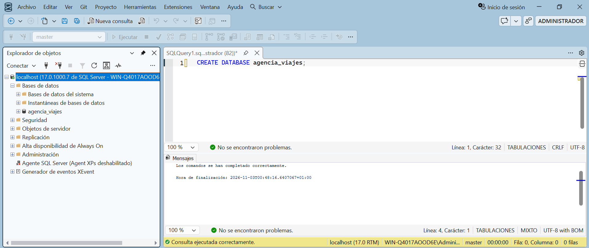
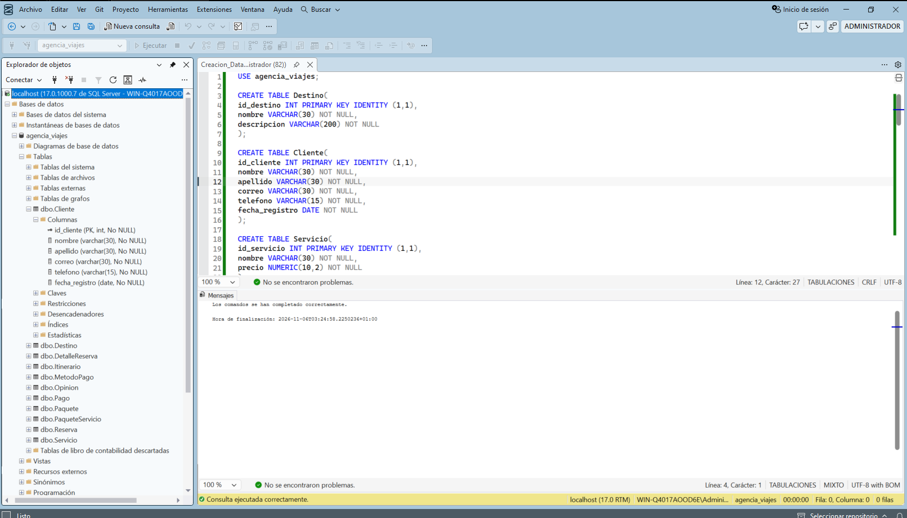
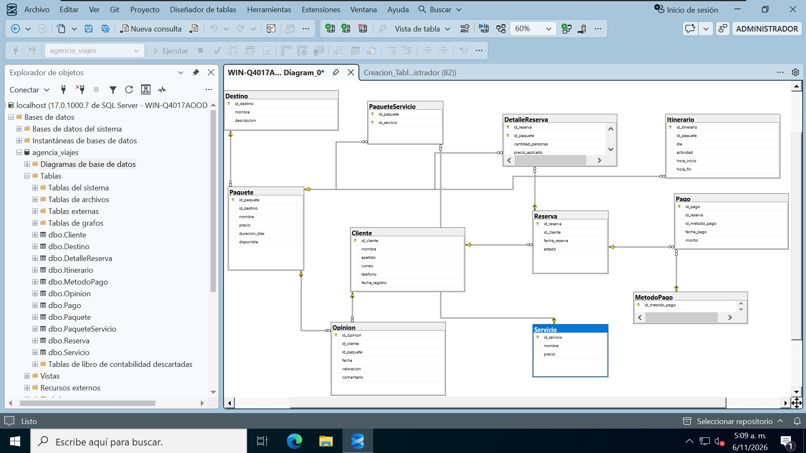

# 02 - Creación de la base y las tablas

> **Fase:** 2 (Creación de la base y las tablas) **Alcance:** creación de la base de datos `agencia_viajes` en SQL Server y de sus 11 tablas, con llaves primarias, llaves foráneas, restricciones y valores por defecto. **No incluye:** inserción de datos (se hace en `03-insercion-de-datos.md`) ni consultas. **Estado:** la base y las 11 tablas quedan creadas y visibles en el Explorador de objetos.

## 1. Resultado de esta fase

| Parámetro            | Valor                                                                                                                                      |
| -------------------- | ------------------------------------------------------------------------------------------------------------------------------------------ |
| Motor                | SQL Server 2025                                                                                                                            |
| Herramienta          | SQL Server Management Studio (SSMS) 22                                                                                                     |
| Base de datos        | `agencia_viajes`                                                                                                                           |
| Tablas creadas       | 11                                                                                                                                         |
| Orden de creación    | `Destino`, `Cliente`, `Servicio`, `MetodoPago`, `Paquete`, `Itinerario`, `Reserva`, `PaqueteServicio`, `DetalleReserva`, `Pago`, `Opinion` |

## 2. Creación de la base de datos

Desde una consulta nueva conectada al servidor local se ejecuta:

```sql
CREATE DATABASE agencia_viajes;
```

SSMS responde que los comandos se completaron correctamente, y `agencia_viajes` aparece en **Bases de datos** del Explorador de objetos.

<p align="center"></p>


## 3. Conceptos que se aplican en el script

### 3.1 Llave primaria (PK)

Es la columna (o el conjunto de columnas) que identifica de forma única cada fila de una tabla. No admite valores repetidos ni nulos. Cada tabla tiene una.

### 3.2 Llave foránea (FK)

Es una columna que apunta a la llave primaria de otra tabla y obliga a que el valor exista allí. Así la base impide, por ejemplo, registrar un paquete de un destino que no existe.

**La columna FK va en el lado "muchos".** Un destino puede tener muchos paquetes, pero cada paquete tiene un solo destino. Por eso `id_destino` está en `Paquete` y no al revés: una fila del lado "muchos" guarda un único valor que apunta a su fila del lado "uno". Poner la FK en `Destino` obligaría a guardar varios valores en una sola columna.

### 3.3 Tabla con id propio y tabla intermedia

|Tipo|Tablas|Llave primaria|IDENTITY|
|---|---|---|---|
|Con id propio|`Destino`, `Cliente`, `Servicio`, `MetodoPago`, `Paquete`, `Itinerario`, `Reserva`, `Pago`, `Opinion`|Una columna `id_...`|Sí, `IDENTITY (1,1)`|
|Intermedia|`PaqueteServicio`, `DetalleReserva`|Compuesta por dos columnas|No|

- **Con id propio:** la fila representa una entidad por sí misma. `IDENTITY (1,1)` hace que SQL Server genere el id, empezando en 1 y sumando de 1 en 1.
- **Intermedia:** resuelve una relación muchos a muchos (un paquete incluye varios servicios y un servicio está en varios paquetes; una reserva incluye varios paquetes y un paquete aparece en varias reservas). Su llave primaria es la combinación de las dos FK, lo que impide repetir la misma pareja. No necesita id propio ni `IDENTITY`.

### 3.4 Orden de creación

Una FK solo puede apuntar a una tabla que ya existe. Por eso las tablas se crean de padres a hijas:

1. Sin dependencias: `Destino`, `Cliente`, `Servicio`, `MetodoPago`.
2. Dependen de las anteriores: `Paquete` (de `Destino`), `Reserva` (de `Cliente`).
3. Dependen de `Paquete` o `Reserva`: `Itinerario`, `PaqueteServicio`, `DetalleReserva`, `Pago`, `Opinion`.

### 3.5 Nombres de restricciones

Las llaves foráneas se nombran con el patrón `fk_hija_padre` (tabla que tiene la FK, luego la tabla a la que apunta), y las llaves primarias compuestas con `pk_tabla`. Nombres usados en el script:

| Restricción                   | Tipo         | Tabla             |
| ----------------------------- | ------------ | ----------------- |
| `fk_paquete_destino`          | FK           | `Paquete`         |
| `fk_itinerario_paquete`       | FK           | `Itinerario`      |
| `fk_reserva_cliente`          | FK           | `Reserva`         |
| `pk_paqueteservicio`          | PK compuesta | `PaqueteServicio` |
| `fk_paqueteserviciopaquete`   | FK           | `PaqueteServicio` |
| `fk_paqueteservicio_servicio` | FK           | `PaqueteServicio` |
| `pk_detallereserva`           | PK compuesta | `DetalleReserva`  |
| `fk_detallereserva_reserva`   | FK           | `DetalleReserva`  |
| `fk_detallereserva_paquete`   | FK           | `DetalleReserva`  |
| `fk_pago_reserva`             | FK           | `Pago`            |
| `fk_metodopago`               | FK           | `Pago`            |
| `fk_opinion_cliente`          | FK           | `Opinion`         |
| `fk_opinion_paquete`          | FK           | `Opinion`         |

Las llaves primarias de las tablas con `IDENTITY` se declaran en la propia columna (`PRIMARY KEY`) sin nombre explícito, por lo que SQL Server les asigna uno automático.

**Recurso complementario:** []()

## 4. Creación de las tablas

### 4.1 Script

Las 11 tablas se crean en un solo script, que empieza con `USE agencia_viajes;` para ejecutarlo sobre la base recién creada. Dos fragmentos como referencia:

```sql
-- Tabla con id propio y una FK (lado "muchos")
CREATE TABLE Paquete(
id_paquete INT PRIMARY KEY IDENTITY (1,1),
id_destino INT NOT NULL,
CONSTRAINT fk_paquete_destino FOREIGN KEY(id_destino) REFERENCES Destino(id_destino),
);

-- Tabla intermedia: PK compuesta, sin IDENTITY
CREATE TABLE PaqueteServicio(
id_paquete INT NOT NULL,
id_servicio INT NOT NULL,
CONSTRAINT pk_paqueteservicio PRIMARY KEY (id_paquete, id_servicio),
);
```

### 4.2 Relaciones entre tablas

|Tabla hija|Columna FK|Tabla padre|
|---|---|---|
|`Paquete`|`id_destino`|`Destino`|
|`Itinerario`|`id_paquete`|`Paquete`|
|`Reserva`|`id_cliente`|`Cliente`|
|`PaqueteServicio`|`id_paquete`, `id_servicio`|`Paquete`, `Servicio`|
|`DetalleReserva`|`id_reserva`, `id_paquete`|`Reserva`, `Paquete`|
|`Pago`|`id_reserva`, `id_metodo_pago`|`Reserva`, `MetodoPago`|
|`Opinion`|`id_cliente`, `id_paquete`|`Cliente`, `Paquete`|

### 4.3 Ejecución

Al ejecutar el script, SSMS informa que los comandos se completaron correctamente.

<p align="center"></p>


## 5. Verificación en el Explorador de objetos

Tras actualizar el Explorador de objetos, bajo `agencia_viajes` → **Tablas** aparecen las 11 tablas: `dbo.Cliente`, `dbo.Destino`, `dbo.DetalleReserva`, `dbo.Itinerario`, `dbo.MetodoPago`, `dbo.Opinion`, `dbo.Pago`, `dbo.Paquete`, `dbo.PaqueteServicio`, `dbo.Reserva` y `dbo.Servicio`. La captura anterior muestra además las columnas de `dbo.Cliente`, con `id_cliente` como PK y el resto de columnas `NOT NULL`.

Las llaves de `Paquete` y de las tablas intermedias no se verificaron en el explorador: 

<p align="center"></p>

**Siguiente:** `03-insercion-de-datos.md`
