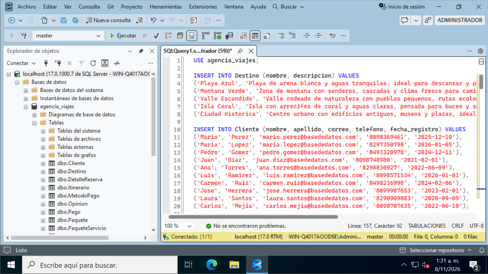
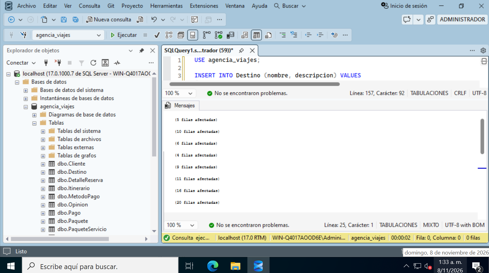
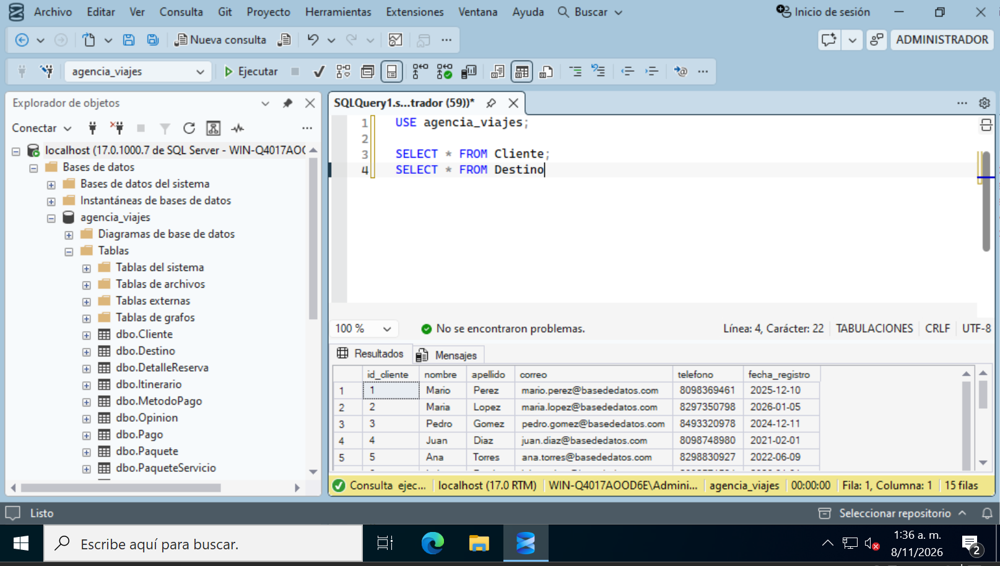
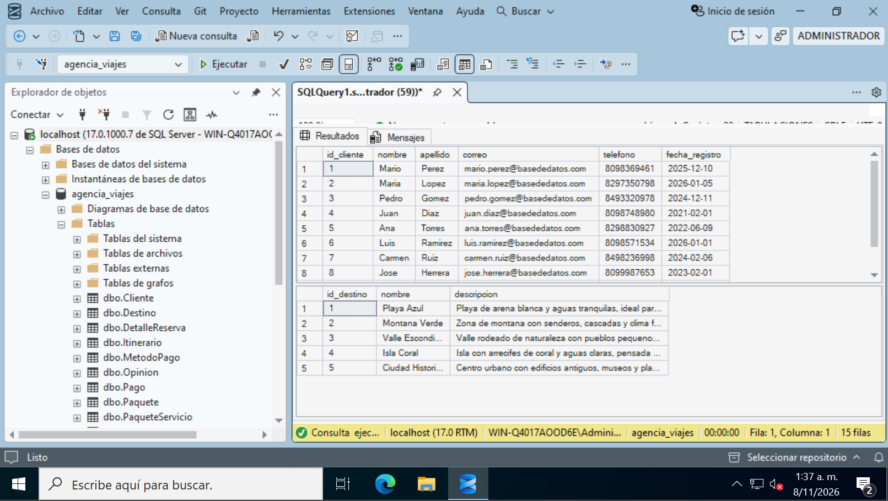

# 03 - Inserción de datos

> **Fase:** 3 (Inserción de datos) **Alcance:** inserción de datos de prueba inventados en las 11 tablas de `agencia_viajes` con `INSERT`, respetando el orden de las llaves foráneas, y verificación con `SELECT`. **No incluye:** consultas, vistas ni procedimientos (se hacen después) ni cambios en la estructura de las tablas (`02-creacion-base-y-tablas.md`). **Estado:** el script de datos está ejecutado; los mensajes de las tres últimas inserciones y la verificación de las demás tablas están pendientes de captura.

## 1. Resultado de esta fase

| Parámetro | Valor |
| --- | --- |
| Base de datos | `agencia_viajes` |
| Tablas con datos | 11 |
| Orden de inserción | `Destino`, `Cliente`, `Servicio`, `MetodoPago`, `Paquete`, `Itinerario`, `Reserva`, `PaqueteServicio`, `DetalleReserva`, `Pago`, `Opinion` |
| Forma de insertar | Un `INSERT INTO ... VALUES` por tabla, con varias filas por orden |
| Ids de las tablas con `IDENTITY` | Los genera SQL Server; no se escriben |
| Verificación | `SELECT * FROM Cliente;` y `SELECT * FROM Destino;` |

## 2. Criterio de los datos

Todos los datos son inventados. Los destinos, paquetes y servicios tienen nombres genéricos, los clientes usan nombres y apellidos comunes, los correos usan un dominio genérico y los teléfonos son números inventados. 

Además de ser ficticios, los datos se pensaron para que las consultas posteriores devuelvan resultados con sentido:

| Tabla | Qué contienen los datos | Por qué |
| --- | --- | --- |
| `Destino` | 5 destinos de tipos distintos (playa, montaña, valle, isla, ciudad) | Poder agrupar y ordenar ventas por destino |
| `Cliente` | 10 clientes con fechas de registro de distintos años; uno no tiene ninguna reserva | Que las consultas por cliente muestren también el caso de cero reservas |
| `Servicio` | 6 servicios con nombres que empiezan por letras distintas | Que el orden alfabético se note en la vista de precios |
| `MetodoPago` | 4 métodos de pago | Agrupar ingresos por método |
| `Paquete` | 9 paquetes, de 1 a 2 por destino; 2 con `disponible = 0` | Filtrar los disponibles |
| `Itinerario` | 11 actividades repartidas en 3 paquetes | Consultar actividades y horarios de un paquete |
| `Reserva` | 16 reservas entre enero y septiembre de 2026, con estados `Confirmada`, `Pendiente` y `Cancelada` | Agrupar por mes y comparar clientes |
| `PaqueteServicio` | 20 parejas, sin repetir ninguna | Varios servicios por paquete |
| `DetalleReserva` | 20 filas; algunas reservas incluyen dos paquetes | Contar paquetes vendidos y cubrir el muchos a muchos |
| `Pago` | 20 pagos entre enero y septiembre, con los 4 métodos; algunas reservas se pagan en dos pagos | Resumir ingresos por mes y por método |
| `Opinion` | 13 opiniones positivas y negativas en varios meses | Calcular porcentajes por fecha y destino |

## 3. Cómo se insertan los datos

### 3.1 La orden `INSERT`

`INSERT INTO` indica la tabla y las columnas que se van a llenar, y `VALUES` lista las filas, separadas por comas. Con una sola orden se insertan varias filas. Fragmento de referencia:

```sql
INSERT INTO Destino (nombre, descripcion) VALUES
('Playa Azul', 'Playa de arena blanca y aguas tranquilas...'),
('Montana Verde', 'Zona de montana con senderos...');
```

Reglas que se aplican en todo el script:

- El texto va entre comillas simples y las fechas en formato `'AAAA-MM-DD'`.
- Las horas van como `'HH:MM'` y los decimales con punto.
- `disponible` es `BIT`: `1` es disponible y `0` no disponible.
- Los números también están escritos entre comillas en algunas columnas (por ejemplo, `'1'`); SQL Server los convierte al tipo de la columna.

### 3.2 El id no se inserta

En las tablas con `IDENTITY (1,1)`, el id lo genera SQL Server: la primera fila recibe el 1, la segunda el 2, y así. Por eso las llaves foráneas del script usan esos números: la reserva del cliente `1` apunta al primer cliente insertado. En las dos tablas intermedias no hay `IDENTITY`: sus ids son las dos llaves foráneas.

### 3.3 Orden de inserción

Una fila solo se puede insertar si la fila a la que apunta ya existe. Por eso se inserta de padres a hijas, igual que en la creación de las tablas:

1. Sin dependencias: `Destino`, `Cliente`, `Servicio`, `MetodoPago`.
2. Dependen de las anteriores: `Paquete` (de `Destino`) y `Reserva` (de `Cliente`).
3. Dependen de `Paquete`, `Reserva` o ambas: `Itinerario`, `PaqueteServicio`, `DetalleReserva`, `Pago` y `Opinion`.

Los ids empiezan en 1 solo si las tablas están recién creadas. Si el script se ejecuta dos veces, los ids siguen subiendo y las llaves foráneas del script ya no coinciden con las filas. Para repetirlo desde cero hay que volver a un estado con las tablas vacías.

Script completo: [PENDIENTE: enlace al script de datos]

**Recurso complementario:** [PENDIENTE: enlace]

## 4. Ejecución

Se abre una consulta nueva, se pega el script (que empieza con `USE agencia_viajes;`) y se pulsa **Ejecutar**.

<p align="center"></p>

Al terminar, el panel **Mensajes** informa de las filas afectadas por cada `INSERT`.

<p align="center"></p>

| Tabla | Filas en el script | Mensaje visto en la captura |
| --- | --- | --- |
| `Destino` | 5 | 5 filas afectadas |
| `Cliente` | 10 | 10 filas afectadas |
| `Servicio` | 6 | 6 filas afectadas |
| `MetodoPago` | 4 | 4 filas afectadas |
| `Paquete` | 9 | 9 filas afectadas |
| `Itinerario` | 11 | 11 filas afectadas |
| `Reserva` | 16 | 16 filas afectadas |
| `PaqueteServicio` | 20 | 20 filas afectadas |

La captura muestra los mensajes de las ocho primeras inserciones.

## 5. Verificación con `SELECT`

Para comprobar que los datos quedaron guardados se consultan las tablas con `SELECT * FROM`, que devuelve todas las columnas y todas las filas. Se ejecutan dos consultas:

```sql
SELECT * FROM Cliente;
SELECT * FROM Destino;
```

SSMS devuelve un resultado por consulta y la barra de estado indica 15 filas en total, que coincide con las 10 de `Cliente` y las 5 de `Destino`.

<p align="center"></p>

En `Cliente` el `id_cliente` empieza en 1 y sube de uno en uno, y en `Destino` el `id_destino` va del 1 al 5, lo que confirma que `IDENTITY` generó los ids como se esperaba.

<p align="center"></p>

**Siguiente:** `04-diagrama-y-relaciones.md`
