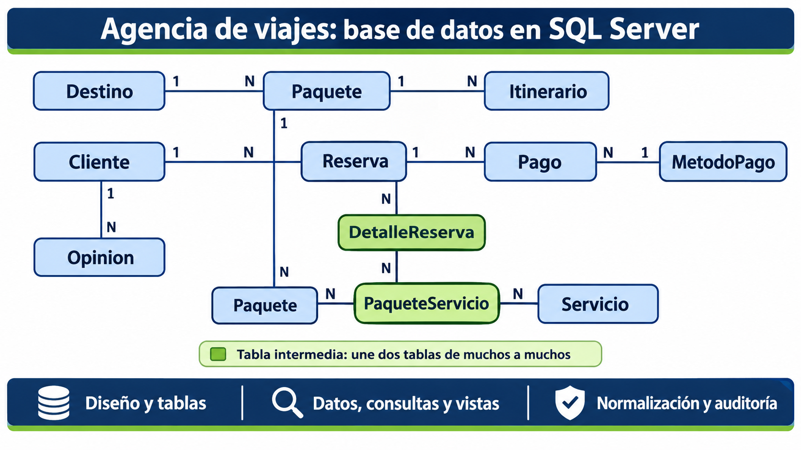

# 04 - Diagrama y relaciones

> **Fase:** 4 (Diagrama y relaciones) **Alcance:** diagrama entidad-relación de `agencia_viajes` y explicación del tipo de relación entre sus tablas. **No incluye:** cambios en la estructura de las tablas (`02-creacion-base-y-tablas.md`) ni la normalización (`05-normalizacion.md`). **Estado:** explicación redactada; el diagrama está pendiente de captura.

## 1. Resultado de esta fase

|Parámetro|Valor|
|---|---|
|Tablas en el diagrama|11|
|Relaciones de uno a muchos|7|
|Relaciones de muchos a muchos|2 (resueltas con tablas intermedias)|
|Relaciones de uno a uno|Ninguna|
|Herramienta|Diagramas de base de datos de SSMS|

## 2. Diagrama entidad-relación

El diagrama se genera desde SSMS: en el Explorador de objetos, `agencia_viajes` → **Diagramas de base de datos** → **Nuevo diagrama**, y se agregan las 11 tablas. SSMS dibuja solo las líneas de las llaves foráneas.

## 3. Cómo leer el diagrama

- Cada recuadro es una tabla, con sus columnas.
- La llave dorada marca la llave primaria.
- Cada línea es una llave foránea: sale de la tabla hija y llega a la tabla padre.
- El extremo con la llave es el lado "uno" y el extremo con el infinito es el lado "muchos".

## 4. Tipo de relación entre las tablas

### 4.1 Uno a muchos

Una fila de la tabla padre se relaciona con muchas filas de la tabla hija, pero cada fila de la hija pertenece a una sola del padre. La llave foránea siempre está en la tabla hija.

|Relación|Tabla con la FK|Explicación|
|---|---|---|
|`Destino` - `Paquete`|`Paquete` (`id_destino`)|Un destino tiene varios paquetes; cada paquete va a un solo destino|
|`Paquete` - `Itinerario`|`Itinerario` (`id_paquete`)|Un paquete tiene varias actividades; cada actividad es de un solo paquete|
|`Cliente` - `Reserva`|`Reserva` (`id_cliente`)|Un cliente hace varias reservas; cada reserva es de un solo cliente|
|`Reserva` - `Pago`|`Pago` (`id_reserva`)|Una reserva puede pagarse en varios pagos; cada pago es de una sola reserva|
|`MetodoPago` - `Pago`|`Pago` (`id_metodo_pago`)|Un método se usa en muchos pagos; cada pago usa un solo método|
|`Cliente` - `Opinion`|`Opinion` (`id_cliente`)|Un cliente escribe varias opiniones; cada opinión es de un solo cliente|
|`Paquete` - `Opinion`|`Opinion` (`id_paquete`)|Un paquete recibe varias opiniones; cada opinión evalúa un solo paquete|

### 4.2 Muchos a muchos

Una relación de muchos a muchos no se puede guardar con una sola llave foránea, así que se resuelve con una tabla intermedia. Esa tabla se convierte en el lado "muchos" de dos relaciones de uno a muchos.

|Relación|Tabla intermedia|Explicación|
|---|---|---|
|`Reserva` - `Paquete`|`DetalleReserva`|Una reserva puede incluir varios paquetes y un paquete puede estar en varias reservas|
|`Paquete` - `Servicio`|`PaqueteServicio`|Un paquete puede incluir varios servicios y un servicio puede estar en varios paquetes|

La llave primaria de cada tabla intermedia es la pareja de sus dos llaves foráneas, así que la misma pareja no puede repetirse. `DetalleReserva` además guarda datos propios de la pareja: la cantidad de personas y el precio aplicado.

**Siguiente:** `05-normalizacion.md`
